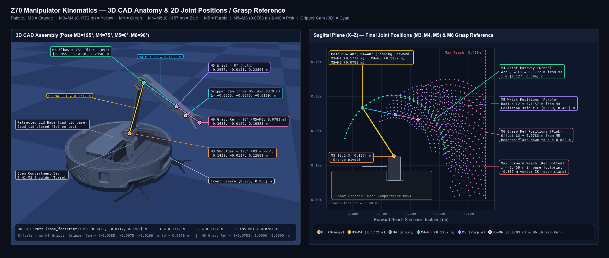

# Z70 Arm Geometry, Kinematics, and Control Protocol

The **CAD & Optical Model in REP-103 `base_footprint` (`src/z70_description/`)** is the single source of truth for all physical robot and arm measurements across the codebase, URDF/TF tree, 3D visualization, camera ray projection, and collision/swept-volume planning.

A secondary helper in `z70_description.arm_model` (`vendor_forward`, `vendor_inverse`, `vendor_check`) mirrors the Roborock Android plugin (`index.android.hasm`, Function `#32735`, app 4.74.08) strictly to predict firmware command admission (`checkArmInvalidAction`, `40 mm` Cartesian IK step discretization, and the `0.367 m` vendor-frame reach clamp). Physically, both describe the same arm: the vendor plugin's 2-link model (`SHOULDER = (0.0475, 0.14) m`, `VENDOR_L1 = 0.1775 m`, `VENDOR_L2 = 0.205 m`) combines forearm `L2` (`0.1157 m`) and wrist-to-jaw grasp reach (`0.0853 m`, sum `0.2010 m ≈ 0.205 m`) into a single elbow-to-tip link and measures `+x` from `arm_vendor_frame` near the circular chassis center (`arm_origin_x_m = 0.1010 m` in `base_footprint`, so `0.1010 + 0.0419 = 0.1429 m` at `M3`).

---

## 1. Geometry and Configuration Sources

Paths below are relative to `src/z70_description/`.

| Source | Geometry and Role |
| :--- | :--- |
| [`config/cad_arm.yaml`](../src/z70_description/config/cad_arm.yaml) & [`meshes/cad/`](../src/z70_description/meshes/cad/README.md) | CAD link lengths `L1 = 0.1772 m` (`M3 -> M4`), `L2 = 0.1157 m` (`M4 -> M5`); shoulder pivot `[0.1429, -0.0117, 0.1266] m` in `base_footprint`; wrist camera offset `[0.0355, 0.0075, -0.0109] m`. Drives URDF visual/structural links, `arm_model.cad_forward()`, `arm_model.hand_pose()`, and `planner` physical points (`operational_point()`, `arm_kinematics()`). |
| [`config/mount_calibration.yaml`](../src/z70_description/config/mount_calibration.yaml) | Front camera mount (`x = 0.275 m`, `z = 0.0582 m`), arm-frame yaw/origin alignment, `M3` angular offset, and underside `ID68` marker transform used by `perception.front_jaw()`. |
| [`config/pincher_geometry.yaml`](../src/z70_description/config/pincher_geometry.yaml) | Housing and finger collision boxes, grasp reference point (`+0.0853 m` ahead of `M5`), 15 mm clearance margin, and jaw `opening_ratio = 2/3`. |
| [`z70_description/arm_model.py`](../src/z70_description/z70_description/arm_model.py) | `cad_forward(state)` returning `(shoulder, elbow, wrist, grasp)` in `base_footprint`, plus `vendor_forward()`, `vendor_inverse()`, and `vendor_check()` implementing the app's 2-D sagittal model strictly for firmware admission diagnostics. |

---

## 2. Joint Conventions and URDF Mapping

Physical poses use REP-103 `base_footprint` (`+x` forward, `+y` left, `+z` up). `arm_wrist_link` sits at the CAD `M5` station (`0.1157 m` from `M4`), with `+x` along the forearm and `+z` along the unrolled top cover normal. Camera optical frames use `+z` forward, `+x` right, `+y` down.

`z70_driver.driver.app_to_urdf()` converts vendor joint angles (degrees) to URDF joint coordinates (radians):

| Joint | Role | Vendor Range | URDF Conversion | Notes |
| :--- | :--- | :--- | :--- | :--- |
| **M3** | Shoulder pitch | `90° .. 270°` | `rad(M3 - 270)` | Sagittal link 1 angle is `270° - M3` (from `+x` toward `+z`). |
| **M4** | Elbow pitch | `35° .. 170°` | `rad(180 - M4)` | Sagittal link 2 angle is `M4 - M3 + 90°`. Holding `M4 - M3` constant keeps forearm pitch level. |
| **M5** | Wrist roll | `0° .. 155°` | `-rad(M5)` (axis `-x`) | Positive vendor `M5` rolls the hand and gripper camera positively about forearm `+x`. |
| **M6** | Gripper jaws | `0°` (closed), `90°` (open) | `rad(M6) / 2` | Collision fingers and CAD jaws mimic the drive joints with multiplier `2 * opening_ratio`. |

---

## 3. Manual Arm Control Protocol and Firmware Behavior

### Session Modes and `common_status` Bitfield

Arm control requires entering an active pickup session via `app_pick_up_enter_exit: {"flag": 0 | 1 | 2}` (exposed on `/z70/arm/operation` as operations `6`, `7`, and `8`).

The robot's `get_status` response reports arm session and action state inside `common_status`:
- **`grab_mode = (common_status >> 10) & 0x3`:**
  - `0`: Off (`robot_state = 3` Idle / `8` Charging)
  - `1`: **Manual Arm Mode** (`flag: 1`, `robot_state = 39`). Enables manual joint/IK jogging and in-place jaw release.
  - `2`: **Video Remote-Pickup Mode** (`flag: 2`). Required by the gripper camera stream (`stream_type = 1`); in this mode `app_put_down` triggers an autonomous lowering/chassis-turning macro.
  - Switching between `flag: 1` and `flag: 2` while the arm is deployed preserves the physical arm pose without movement.
- **`grab_status = (common_status >> 6) & 0xf`:**
  - `0`: Stowed in compartment
  - `1`: Leaving compartment (deploying)
  - `2`: Entering compartment (stowing)
  - `3`: Deployed and waiting for command
  - `4`: Grasping (`app_grip`)
  - `5`: Putting down (`app_put_down`)
  - `7`: Continuing action
  - `8`: Switching mode
  - `9`: Continuing grasp
  - `10`: Continuing put-down

### Arm Lifecycle and Gripper RPCs (`/z70/arm/operation`)

| `ArmOperation` | Wire RPC | Behavior |
| :--- | :--- | :--- |
| `1` | `app_arm_out_compartment: {}` | Unstows the arm to `WORKING_POS` `(150°, 45°, 0°, 90°)`. Firmware may rotate the chassis during its obstruction check. |
| `2` | `app_arm_in_compartment: {}` | Stows the arm into the chassis compartment (`IN_ROBOT`). |
| `3` | `app_open_gripper: {}` | Fault-recovery jaw open (used by the abnormal-arm recovery wizard). |
| `4` | `app_grip: {}` | Closes the gripper jaws in place without lifting the arm. |
| `5` | `app_put_down: {"flag": 0}` | Mode-dependent release: in Manual Mode (`grab_mode == 1`), opens the jaws in place while preserving arm pose (`IN_PROCESS_POS`, `M6 = 90°`). In Remote-Pickup Mode (`grab_mode == 2`), runs the autonomous floor put-down sequence. |
| `6` | `app_pick_up_enter_exit: {"flag": 1}` | Enters Manual Arm Mode (`grab_mode = 1`). |
| `7` | `app_pick_up_enter_exit: {"flag": 2}` | Enters Video Remote-Pickup Mode (`grab_mode = 2`). |
| `8` | `app_pick_up_enter_exit: {"flag": 0}` | Exits arm control mode (`grab_mode = 0`); stows the arm if deployed. |
| `9` | `app_arm_recover: {}` | Runs the firmware arm break/fault recovery sequence. |

### Joint Steps, Simultaneous Multi-Axis Moves, and Cartesian IK Steps

- **Direct & Coordinated Joint Steps (`app_arm_move: {"m": [m3, m4, m5]}`, `/z70/arm/step`):**
  - Each slot in `m[0..2]` selects the directional step for `M3`, `M4`, and `M5`: `0` = hold, `1` = `+10°` nominal, `2` = `−10°` nominal. Values outside `{1, 2}` (such as `-1` or `10`) are ignored by the firmware. If a 5-element array is passed (`remoteManualArmPickUp`), the firmware reads `m[0..2]` and ignores `m[3..4]`.
  - **Simultaneous multi-axis execution:** Setting multiple slots in `m[0..2]` to `1` or `2` actuates those joints simultaneously in a single step:
    - `[1, 1, 0]` (`ArmStep.joint = 34, direction = 1`) and `[2, 2, 0]` (`joint = 34, direction = -1`) rotate `M3` and `M4` together in the same direction, translating the hand down-out or up-in while keeping the forearm world pitch angle (`M4 - M3 + 90°`) constant.
    - `[1, 2, 0]` (`joint = 43, direction = 1`) and `[2, 1, 0]` (`joint = 43, direction = -1`) rotate `M3` and `M4` in opposite directions to extend or retract reach.
    - `m[2]` (`1` or `2`) can be combined with `m[0..1]` for simultaneous 3-axis `M3/M4/M5` steps.
  - **Step atomicity & continuous jogging:** A single 10° step is atomic once dispatched (`app_stop_grasp: []` does not halt a 10° step mid-rotation). Continuous manual jogging is achieved by repeating step RPCs while a control is held and sending `app_stop_grasp: []` on release.
- **Cartesian IK Hand Steps (`app_arm_direction_move: {"direction": 1..4}`, `/z70/arm/hand_step`):**
  - `1` = Up (vendor sagittal `+y` / `base_footprint +z`), `2` = Down (vendor sagittal `−y` / `base_footprint −z`), `3` = Forward (`+x`), `4` = Back (`−x`).
  - Displaces the vendor planar endpoint by `0.04 m` along the requested axis and solves 2-link IK (`vendor_inverse`) on the current elbow branch.
- **Program Mode (`app_start_program`, `app_save_program`, `app_get_program`):**
  - Blockly editor blocks `arm_m3..arm_m6` compile to `{"cmd_id": "arm_joints", "value": [M3, M4, M5, M6], "step": N}`, where `step` is the count of 10° increments (`1..20`) and the first non-zero slot in `M3 -> M4 -> M5 -> M6` takes priority.
- **Joint Telemetry (`app_get_arm_joints_data: {}`):**
  - Returns `{"data": [0, 0, 0]}` across stowed, manual (`flag: 1`), and remote-pickup (`flag: 2`) modes. Because the firmware does not report live joint encoder angles on this RPC, `z70_driver` tracks joint state via `ArmEstimator` dead reckoning anchored on stow/unstow events and explicit visual anchors (`/z70/arm/anchor`).

---

## 4. Vendor Predictive Model (`arm_model.py`)

Recovered from `index.android.hasm` Function `#32735` (`ForwardKinematics` `#32739`, `InverseKinematics` `#32740`, `checkArmInvalidAction` `#32744`, `RecordRealPos` `#32742`, `GetMaxStep` `#32745`):

### Sagittal Geometry (`x` forward, `y` up, metres)

| Parameter | Value | Source |
| :--- | :--- | :--- |
| Shoulder pivot `SHOULDER` (`m2_pos`) | `(0.0475, 0.14) m` | `#32741` |
| Upper arm `VENDOR_L1` (`M3 -> M4`) | `0.1775 m` | `#32739`, `#32740` |
| Forearm `VENDOR_L2` (`M4 -> end_pos`) | `0.205 m` | `#32739`, `#32740` |
| Reach refusal threshold | `x <= 0.367 m` | Observed firmware forward-reach limit enforced in `ArmEstimator` and `planner` |

### Validity Checks (`vendor_check`, `#32744`)

Evaluated in order:
1. `M3 in [90°, 270°]`, `M4 in [35°, 170°]`, `M5 in [0°, 155°]` -> `FAULT_JOINT_LIMIT`
2. `end.y > 0.37 m` -> `FAULT_ARM_HEIGHT`
3. `|end.x| < 0.24 m` and `end.y < 0.14 m` -> `FAULT_ROBOT_COLLISION`
4. `end.y < 0.01 m` -> `FAULT_GROUND_COLLISION`
5. `|end.x| > 0.37 m` -> `FAULT_PROJECTION`
6. `M4 - M3 + 90° > 15°` -> `FAULT_A4_ANGLE` (forearm cannot pitch more than 15° above horizontal)

### Named Poses (`POSES`, `#32743`)

| State | `M3` | `M4` | `M5` | `M6` | Vendor `end_pos (x, y)` | Transition |
| :--- | :--- | :--- | :--- | :--- | :--- | :--- |
| `IN_ROBOT` | `0°` | `0°` | `0°` | `0°` | `None` (stowed) | Initial state, `app_arm_in_compartment` |
| `WORKING_POS` | `150°` | `45°` | `0°` | `90°` | `(0.1568, 0.2407) m` | `app_arm_out_compartment` |
| `TRANSFER_POS` | `150°` | `75°` | kept | `0°` | `(0.1568, 0.3468) m` | App preview state for autonomous `arm_grasp` |
| `IN_PROCESS_POS` | accumulated | accumulated | accumulated | `0° / 90°` | `vendor_forward(M3, M4)` | Any `app_arm_move`, `app_arm_direction_move`, or manual in-place `app_put_down` |
