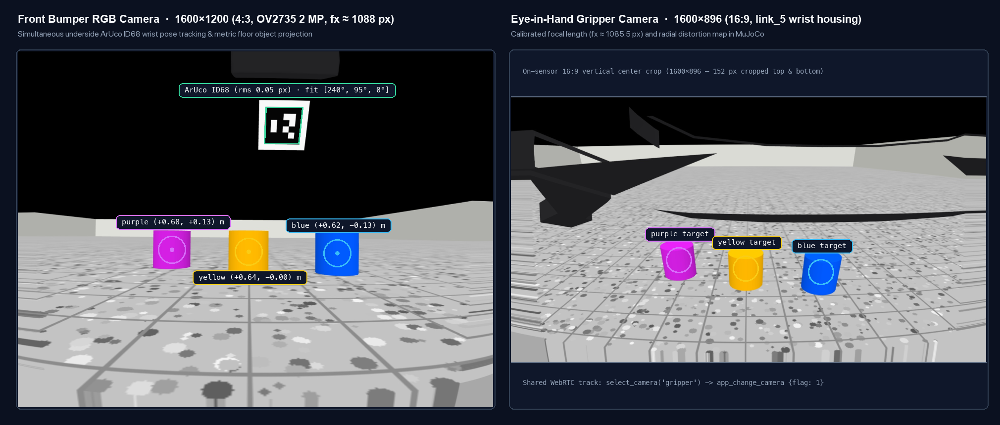

# z70_sim

MuJoCo 3D physics and camera simulator for the stock Roborock Saros Z70 (`roborock.vacuum.a179`).

## Overview

`z70_sim` sits at the private HTTP/SSE transport boundary below `z70_driver`, allowing the entire ROS 2 Lyrical stack (`z70_driver`, `z70_mapping`, `z70_odometry`, `z70_manipulation`, `z70_web_gateway`, and `foxglove_bridge`) to run on macOS Apple Silicon (`osx-arm64`). Simulation launch uses `http://127.0.0.1:57110`, separate from the live transport on `:57010`.



### Simulated Subsystems

- **Kinematics & Meshes (`SimWorld`):** Builds a native MuJoCo MJCF articulation from the installed CAD STL meshes (`src/z70_description/meshes/cad/*.stl`), link lengths (`cad_arm.yaml`), optical mount calibration (`mount_calibration.yaml`), and finger opening coupling (`pincher_geometry.yaml`).
- **Calibrated Dual Cameras (`front` & `gripper`):** Renders offscreen `1600x1200` (`front`) and `1600x896` (`gripper`) frames using the calibrated focal lengths, principal points, and radial distortion maps from `z70_front_camera_info.yaml` and `z70_gripper_camera_info.yaml`.
- **ArUco `ID68` Wrist Marker:** Places the 15 mm `DICT_4X4_1000` `ID68` square marker on the pincher underside (`pincher_marker_68`) so `perception.front_jaw()` and `planner.observed_joints()` recover 6-DOF hand pose and `[M3, M4, M5]` joint angles from rendered front frames.
- **Textured Floor for Homography VO:** Generates a high-feature neutral floor texture so `FloorOdomNode` (`z70_odometry`) computes metric ORB+RANSAC floor visual odometry on `/odom` during simulated `app_rc_move` pulses.
- **Roborock Firmware & V1 Map Emulation (`SimServer`):** Emulates `get_status` (`common_status` grab-status and grab-mode bitfields), `get_camera_status` (`11685` front / `44453` gripper), `get_room_mapping`, `app_pick_up_enter_exit`, `app_arm_out_compartment`, `app_arm_in_compartment`, `app_arm_move` (10° steps with `x <= 0.367 m` ceiling), `app_arm_direction_move` (40 mm IK hand steps), `app_grip`, `app_put_down`, `app_change_camera` (including the firmware no-reply timeout), `app_rc_move`, `app_goto_target`, and segmented `v1` LiDAR maps (`encode_v1_map`, including the 5-room `apartment` preset with `DEFAULT_GARMENTS` and `WASHING_MACHINE_DROP_M`). Also serves `dist/web/` and proxies `/api/ros/*` to the explicitly configured `z70_web_gateway` so the web console (`http://127.0.0.1:57110`) works directly against `pixi run sim`.

## Launch

Start the full ROS 2 stack against the MuJoCo simulator:

```sh
pixi run sim
```

Or via `ros2 launch`:

```sh
pixi run bringup sim:=true web_gateway:=true manipulation:=true
```

Simulation defaults are transport `:57110`, gateway `:57080`, Foxglove `:8865`,
and loopback-only ROS domain `92` (not the inherited live domain). Launch creates
a fresh private temporary directory and prints its path. The generated `0600`
token, arm estimates, chassis calibration, pickup evidence, and patrol ledger
stay inside that directory; live `.local/` credentials and application state are
not reused. Scratch state is retained for inspection after shutdown.

To select another isolated setup, pass launch arguments, for example:

```sh
pixi run sim origin:=http://127.0.0.1:57111 web_gateway_port:=57081 foxglove_port:=8866 sim_domain_id:=98
```

`origin` must be a numeric `127.0.0.1` HTTP endpoint; the simulator and driver use
the same port. Gateway ports must be in `57000–57100`. Live transport/gateway
ports (`57010`, `57020`) and live Foxglove (`8765`) are rejected in simulation.
MCP uses the launch log's `mcp:` gateway, not this transport ([example](../../README.md#mcp-configuration)).
`sim_domain_id` must be in `91–99`; run only one stack per domain. An optional
`sim_state_dir` must name a **new, nonexistent** directory. `token_file` overrides
are rejected in simulation: the launch creates its own token before starting
the simulator and gateway. Hardware sidecars remain disabled even if
`sidecars:=true`, and a simulator exit shuts down the launched stack.

When using `SimServer` or `sim_sidecar` directly, the ROS proxy is disabled
unless `ros_gateway_origin` / `--ros-gateway-origin` is supplied explicitly;
there is no fallback to the live gateway. Normal non-simulation launch defaults
are unchanged.
